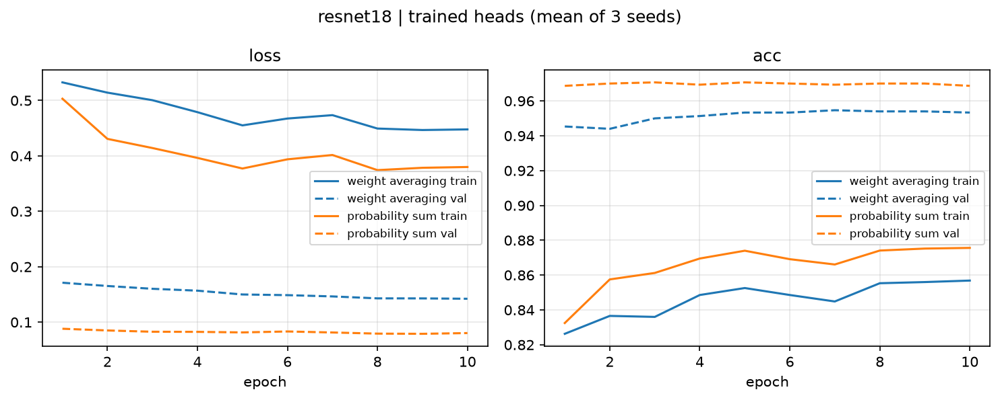

# Experiment 001
## ResNet-18 with weight averaging vs. probability aggregation on ImageNet superclasses
 **Question:** Which model would train better on a superclass of ImageNet if we changed the pre-trained head of ResNet-18 by: 
1. Changing its weights to the mean aggregation of all subclasses to classify its superclass or
2. Keeping all weights, but summing the predicted probabilities of each superclass's subclasses to get the superclass probability.

A course assignment of mine was to perform transfer learning by initializing ResNet-18's pre-trained model with the weight averaging of its head's parameters. It performed well, and much better than the probability aggregate when the "others" class was introduced. However, I wanted to compare their capabilities without considering the "others" class.

I tested the zero-shot baseline models on both the datasets that included and excluded the "others" class, but the trained models were only trained on the version without the "others" class.

## Setup

| | |
|---|---|
| **Model** | ResNet18, ImageNet-pretrained (`IMAGENET1K_V1` weights from torchvision) |
| **Dataset** | Mini-ImageNet PASCAL-10: 10 PASCAL VOC classes, 3,500 training images (350 per class), 500 validation images (50 per class) |
| **Class mapping** | 226 of ImageNet's 1000 classes grouped into the 10 superclasses; the other 774 form the optional "others" group |
| **Training** | Head only (backbone frozen, BatchNorm in eval mode) |
| **Optimizer** | Adam, learning rate 1e-4, no weight decay or scheduler |
| **Loss** | Cross-entropy over the 10 superclasses |
| **Epochs / batch size** | 10 epochs, batch size 32 |
| **Train augmentation** | Random horizontal flip, ±15° rotation, `RandomResizedCrop(224)`, `ColorJitter(1)` |
| **Validation preprocessing** | Resize to 256, center crop 224 |
| **Normalization** | ImageNet mean/std |
| **Seeds** | 42, 123, 456 for training. Results reported as mean ± std. Zero-shot results have no randomness, so they come from a single run |


 **Subclasses Grouped Below**<br>

```
 PASCAL_TO_IMAGENET_IDS = {
    "aeroplane": [404, 895], 
    "bird":      list(range(7, 25)) + list(range(80, 101)) + list(range(127, 147)),
    "boat":      [403, 472, 484, 510, 554, 576, 625, 628, 724, 780, 814, 833, 871, 914],
    "bottle":    [440, 720, 737, 898, 907],
    "bus":       [654, 779, 874],
    "car":       [407, 436, 468, 511, 609, 627, 656, 661, 751, 817],
    "cat":       list(range(281, 286)), 
    "chair":     [423, 559, 765, 857],
    "dog":       list(range(151, 269)),
    "train":     [466, 547, 565, 705, 820, 829],
}
```

## Hypothesis

My hypothesis going into this experiment was that probability aggregation would perform better than weight averaging, since it keeps all 1000 pretrained head weights instead of compressing each superclass into one averaged row. I expected this advantage even without training, as long as the "others" class wasn't included. Including the "others" class would result in a much lower accuracy because the sum of the other 774 class probabilities, although each is small, could exceed the highest superclass probability. Thus, the model would incorrectly predict "others".


## Results

ResNet18 pretrained on ImageNet, evaluated on the 500-image validation set (50 per class). Trained results are mean ± std over 3 seeds; per-class tables are from seed 42.

### Zero-shot (no training)

| Method | Accuracy | Loss | Predicted as "others" |
|---|---:|---:|---:|
| Weight averaging | 92.4% | 0.231 | — |
| **Probability sum** | **95.6%** | **0.141** | — |
| Weight averaging + others | 92.4% | 0.236 | 0.0% |
| Probability sum + others | 83.0% | 0.550 | 16.4% |

<details>
<summary>Per-class accuracy</summary>

| Class | # ImageNet classes | Weight avg | Prob sum | Weight avg + others | Prob sum + others (→ others) |
|---|---:|---:|---:|---:|---:|
| aeroplane | 2 | **100%** | 96% | **100%** | 82% (16%) |
| bird | 59 | **100%** | **100%** | **100%** | **100%** (0%) |
| boat | 14 | 92% | **100%** | 92% | 98% (2%) |
| bottle | 5 | **94%** | **94%** | **94%** | 56% (44%) |
| bus | 3 | 96% | **98%** | 96% | 88% (12%) |
| car | 10 | 84% | **90%** | 84% | 84% (14%) |
| cat | 5 | **98%** | 94% | **98%** | 80% (18%) |
| chair | 4 | **88%** | **88%** | **88%** | 56% (44%) |
| dog | 118 | 84% | **100%** | 84% | 98% (2%) |
| train | 6 | 88% | **96%** | 88% | 88% (12%) |

</details>

### Head-only training (frozen backbone, 10 epochs, Adam, lr 1e-4)

| Method | Trainable params | Before | After (mean ± std) | Per seed (42 / 123 / 456) | Gain |
|---|---:|---:|---:|---:|---:|
| Weight averaging | 5,130 | 92.4% | 95.3% ± 0.3 | 95.6 / 95.0 / 95.4 | +2.9 |
| **Probability sum** | 513,000 | 95.6% | **96.9% ± 0.3** | 97.2 / 96.6 / 96.8 | +1.3 |

<details>
<summary>Per-class accuracy after training (seed 42)</summary>

| Class | Weight avg | Prob sum |
|---|---:|---:|
| aeroplane | **98%** | **98%** |
| bird | **100%** | **100%** |
| boat | **98%** | **98%** |
| bottle | **96%** | **96%** |
| bus | 96% | **100%** |
| car | 84% | **90%** |
| cat | **96%** | **96%** |
| chair | 90% | **96%** |
| dog | **100%** | **100%** |
| train | **98%** | **98%** |

</details>



### Trained heads evaluated with "others"

The heads above were trained without "others"; here an "others" output is added only at evaluation. For probability sum, the trained 1000-class head is re-grouped with the 774-class "others" bucket. For weight averaging, the original averaged "others" row (untrained) is appended to the trained 10-class head.

| Method | Zero-shot + others | Trained + others (mean ± std) | Predicted as "others" (zero-shot → trained) |
|---|---:|---:|---:|
| **Weight averaging** | 92.4% | **95.3% ± 0.3** | 0.0% → 0.0% |
| Probability sum | 83.0% | 88.9% ± 0.2 | 16.4% → 10.5% ± 0.2 |

<details>
<summary>Per-class accuracy, trained + others (seed 42)</summary>

| Class | Weight avg + others | Prob sum + others (→ others) |
|---|---:|---:|
| aeroplane | **98%** | 94% (6%) |
| bird | **100%** | 98% (2%) |
| boat | **98%** | 96% (4%) |
| bottle | **96%** | 76% (24%) |
| bus | **96%** | **96%** (4%) |
| car | 84% | **86%** (10%) |
| cat | **96%** | 82% (16%) |
| chair | **90%** | 70% (30%) |
| dog | **100%** | 96% (4%) |
| train | **98%** | 94% (6%) |

</details>

### Key findings

- **Probability sum beats weight averaging zero-shot** (95.6% vs 92.4%), and its biggest gain is on **dog** (84% → 100%), the superclass with the most subclasses (118). Summing favours large superclasses; the small ones aeroplane and cat lose slightly.
- **Adding "others" hurts only probability sum.** Its "others" bucket sums 774 classes and absorbs 16.4% of images, especially the small superclasses bottle and chair (44% each). The averaged "others" row in weight averaging is never predicted.
- **After training, probability sum stays ahead, and the gap is consistent across seeds.** It averages 96.9% vs 95.3% (a 1.5-point gap), wins on every seed by 1.4–1.6 points, and the two methods' per-seed ranges don't overlap (96.6–97.2% vs 95.0–95.6%). Weight averaging improves more during training (+2.9 vs +1.3), narrowing but not closing the zero-shot gap.
- **Training partly fixes the "others" problem for probability sum.** Images predicted as "others" drop from 16.4% to 10.5% and accuracy rises from 83.0% to 88.9%: training raises the 226 grouped classes while the 774 unrelated classes get no gradient. Bottle and chair are still hit hardest (24% and 30% sent to "others" in seed 42). Weight averaging still never predicts "others".
- **Validation accuracy is higher than training accuracy** (~97% vs ~88%) because of strong training augmentation for invariance; validation images aren't augmented, thus the train set is harder.


## Conclusion

The results support both parts of the hypothesis. Without "others", probability aggregation was stronger zero-shot (95.6% vs 92.4%) and remained ahead after head-only training (96.9% ± 0.3 vs 95.3% ± 0.3 over 3 seeds), though weight averaging improved more during training (+2.9 vs +1.3 points), narrowing the gap. The advantage held on every seed, so it is unlikely to be run-to-run noise. With "others", probability aggregation dropped to 83.0% as 16.4% of images were absorbed into the 774-class "others" bucket, while weight averaging was unaffected and never predicted "others". Training reduced this effect (88.9%, 10.5% predicted as "others") but did not remove it, so weight averaging remains the safer choice whenever an "others" class is present.

